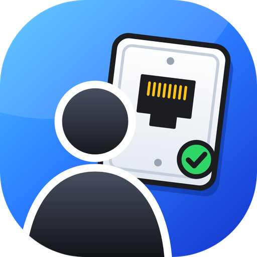
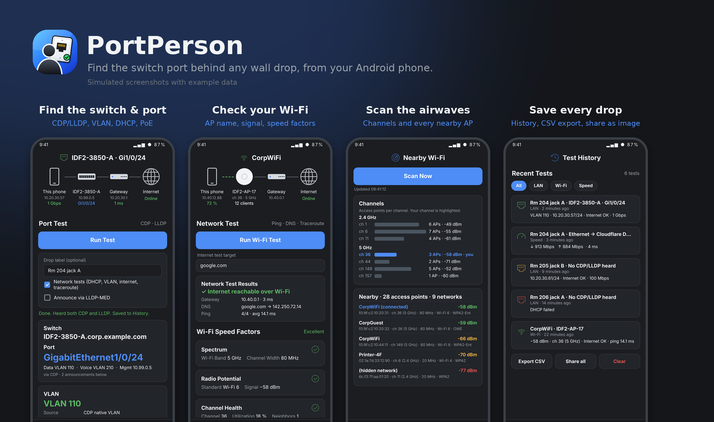
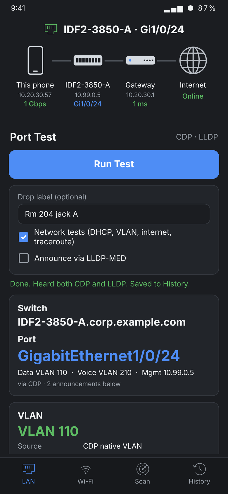
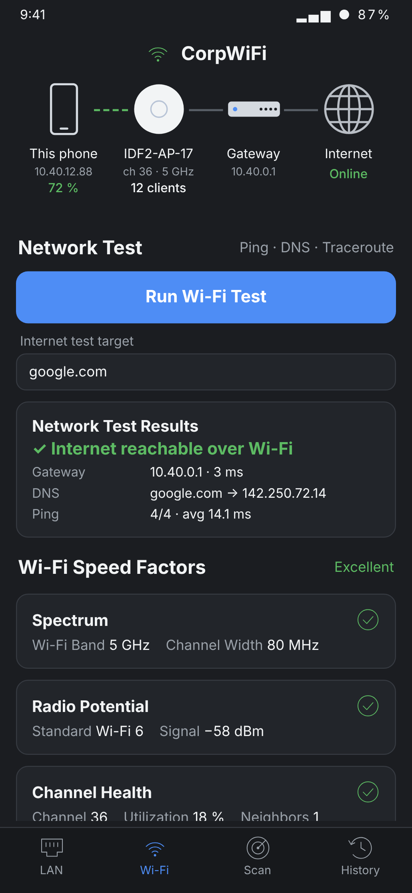
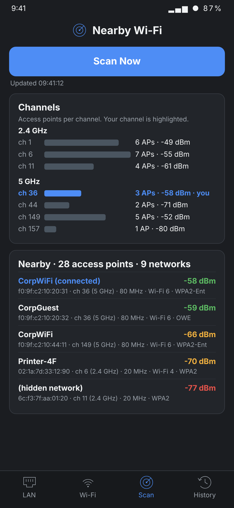
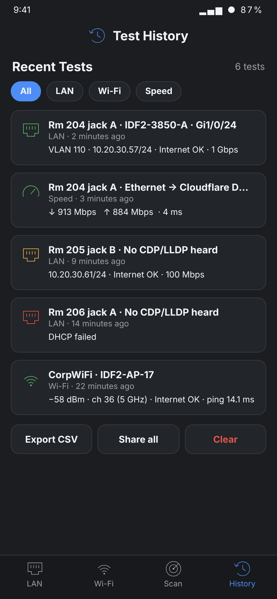
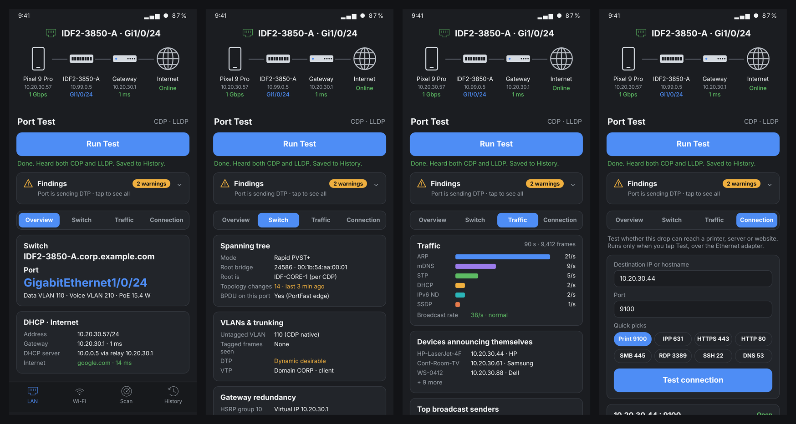
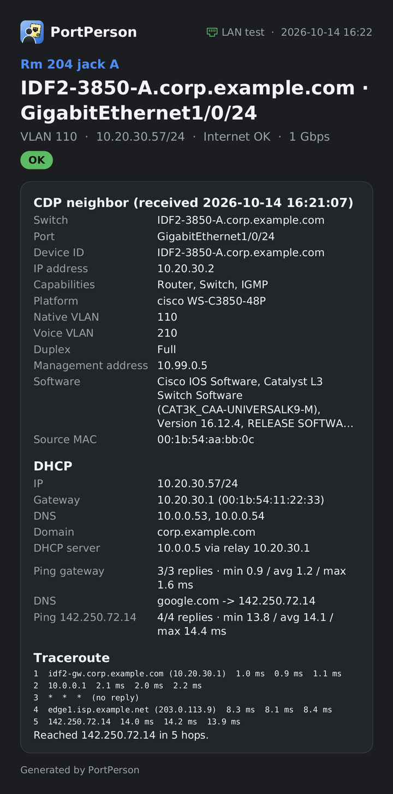

<h1 align="center">PortPerson</h1>

**Find which switch port a network drop connects to, straight from your Android phone.**

Plug a USB Ethernet adapter into your phone, connect the drop, and tap **Run Test**. PortPerson listens for the switch's **CDP** and **LLDP** announcements and shows the switch name, port, VLANs and PoE. It then checks DHCP, the internet path and speed over that drop. It also has a Wi-Fi tab and a Wi-Fi scanner.

No root needed. No ads, no accounts, no tracking. Made by **YZIOHP**. For use on networks you own or are authorized to test ([terms](TERMS.md)).

> **Built with Claude.** This app was designed and written with the help of [Claude](https://claude.ai), Anthropic's AI assistant. All the code was generated by AI and reviewed and tested by YZIOHP. Test it on your own network before you rely on it, and please [report problems](../../issues).

Simulated screenshots with example data.

## Download

Get the latest **`PortPerson-v1.1.0.apk`** from [Releases](../../releases). Open it on your phone and allow "Install unknown apps" for your browser or file manager when Android asks.

## What it does

### LAN tab: test a wall drop
- **Switch and port** from CDP (v1/v2) and LLDP, including LLDP-MED, 802.1 and 802.3 extensions: switch name, port, native/voice VLAN, management IP, model, link speed and PoE.
- **Announce via LLDP-MED** (optional): many switches answer within a couple of seconds instead of waiting up to 60 s.
- **DHCP**: whether an address was received, IP/prefix, gateway and its MAC, DNS, domain, DHCP server, relay (`ip helper-address`), lease time and how long it took.
- **VLAN**: the access VLAN as the switch reports it, plus voice VLAN and the subnet DHCP handed out.
- **Internet**: gateway ping, DNS lookup, ping and an **ICMP traceroute** with hop names.
- **Findings**: a collapsible health check after every port test. It flags a second (possibly rogue) DHCP server, 802.1X, loops and broadcast storms, duplicate IPs, DTP trunk negotiation, tagged VLANs, native VLAN mismatches, spanning-tree changes, routing hellos and extra IPv6 routers. Red problems open it automatically.
- **Results in four tabs**:
  - **Overview**: switch, port, VLAN, DHCP and internet results.
  - **Switch**: spanning tree (mode, root bridge, topology changes), VLANs and trunking (tags, DTP, VTP), HSRP/VRRP gateways, routing hellos and IPv6 routers.
  - **Traffic**: frames per second by protocol, broadcast rate, devices announcing themselves (mDNS, NetBIOS, DHCP host names), top broadcast senders, and **Save capture (.pcap)** to open in Wireshark.
  - **Connection Test**: check whether the drop can reach a printer, server or website. Enter an IP or hostname and a port, or pick one (print 9100, IPP 631, HTTPS 443, SMB 445…). Runs only when you tap Test.
- **Speed test** via Cloudflare.
- A network map at the top, read left to right: this phone (with its model name) → switch/port → gateway → Internet.

The LAN tests (except the speed test) run **over the adapter itself, never Wi-Fi or cellular**, using the adapter's own MAC address. The DHCP lease is released when the test ends.

### Wi-Fi tab
- **Connection**: SSID, BSSID, signal, channel/band/width, Wi-Fi standard, security, link rate, IP, gateway, DNS, DHCP server, lease time.
- **Access point**: the AP's **name** read from its beacons (Cisco, Aruba, Juniper Mist, Extreme/Aerohive; WPS device name on home routers). Also its vendor, client count and channel utilization (when advertised), other SSIDs on the same AP, and other APs for your network.
- **Wi-Fi Speed Factors**: Spectrum, Radio Potential and Channel Health, with an overall rating.
- **Network test** over Wi-Fi: gateway ping, DNS, TCP connect, ping and traceroute.
- **Connection Test** over Wi-Fi: the same printer / server / website port check as the LAN tab.
- **Speed test** via Cloudflare.

### Scan tab
- Access points per channel for each band (your channel highlighted), and every nearby AP with signal, channel, width, standard and security.

### History tab
- Every port test, Wi-Fi test and speed test is **saved automatically** on the phone (the last 200).
- Give a test a **drop label** (e.g. "Rm 204 jack A") before running it, or add one afterwards.
- Tap a test for its full report, then share it (as an image or text), rename or delete it. Filter by LAN / Wi-Fi / Speed.
- **Export CSV** for a spreadsheet of every drop you've tested, or **Share all** as text.

## Screens

| LAN | Wi-Fi | Scan | History |
|:---:|:---:|:---:|:---:|
|  |  |  |  |
| Switch, port and VLAN from CDP/LLDP, plus DHCP. The map reads from your phone to the Internet. | Wi-Fi test (ping, DNS, traceroute), the AP you're on and its speed factors, then a Cloudflare speed test. | Channel usage and every nearby access point. | Every test saved, with drop labels, CSV export and sharing. |

**After a port test:** Findings at the top, then the Overview, Switch, Traffic and Connection Test tabs:

**Share as image:** any result can be sent as a report card like this one:

Screens above are simulated with example data; real results depend on your network.

## What you need

- **Android 9 or newer** with USB-C/OTG (practically every modern phone).
- For the LAN tab, a **USB Ethernet adapter** with one of these chips:

| Chip | Works? | Notes |
|---|---|---|
| Realtek RTL8153 / RTL8152 / RTL8156 | ✅ | Most common chip (Anker, UGREEN, Cable Matters, TP-Link UE300 and many more). Uses the standard CDC mode. |
| ASIX AX88179A / AX88179 / AX88178A | ✅ | Driven in the chip's native mode. |
| Other adapters with CDC-ECM or CDC-NCM | ✅ | Any adapter offering the standard USB Ethernet class. |
| Apple USB Ethernet adapter, very old chips | ❌ | The app shows "USB details" so you can see why. |

Docks and hubs usually work. If one doesn't, try plugging the adapter straight into the phone.

## Using it

1. Plug the adapter into the phone and connect the drop.
2. Open PortPerson (Android may offer to open it automatically) and tap **Run Test**. Allow USB access.
3. Results appear as soon as the switch announces itself. That's usually under 60 s, and only seconds with LLDP-MED announce on.
4. Tap **Share results** to send everything **as an image** (a clean report card, great for texts and tickets) **or as text**. The test is also saved in the **History** tab.

While a LAN test runs, the app takes the adapter over from Android. The LAN speed test hands it back automatically. Otherwise, unplug and replug the adapter to use it for normal networking.

**Wi-Fi permissions:** Android only shows Wi-Fi network names and scan results to apps with **Location** permission, and Location must be turned on. PortPerson doesn't use or store your location. Android also limits apps to 4 Wi-Fi scans every 2 minutes. *Developer options → Wi-Fi scan throttling* removes the limit.

## Privacy

PortPerson has no analytics and no accounts. Saved tests stay in the app's private storage on your phone and are only shared when you share or export them. It only contacts the network for tests you start:
- **Speed test**: speed.cloudflare.com (Cloudflare sees your public IP, as with any website).
- **AP vendor lookup**: sends only the vendor half of the AP's MAC address (e.g. `F0:9F:C2`) to api.macvendors.com.
- **Internet tests**: the target you choose (default `google.com`) and your network's own DNS servers.
- **Connection tests**: only the address and port you enter, when you tap Test. PortPerson doesn't scan networks.

During a port test, the frames the switch port delivers are analyzed on the phone and kept in memory until the next test. They're written to a `.pcap` file only when you tap **Save capture**. Capture files can contain other devices' addresses and names, so share them only where you're authorized to.

## How it works

Android doesn't let regular apps read raw Ethernet frames, and CDP/LLDP never reach the IP stack anyway. So for the LAN tab, PortPerson acts as its own small USB Ethernet driver through Android's USB host API. It takes the adapter over, sets it to promiscuous mode, decodes CDP/LLDP, analyzes the other frames the port delivers (spanning tree, DTP/VTP, 802.1X, DHCP, ARP, HSRP/VRRP, routing hellos, IPv6 RAs, mDNS/NetBIOS), and runs its own minimal IPv4 client (DHCP, ARP, ICMP, DNS, traceroute) on raw frames. The speed test needs real TCP/TLS, so it runs over Android's own Ethernet or Wi-Fi network, pinned to that interface. Before measuring, it checks that a test connection really leaves through that interface and shows it (e.g. *Via: Ethernet · eth0 · 10.20.30.57*). If it didn't, the test is cancelled rather than measuring the wrong network. After a port test, the adapter is switched back to its original USB mode so Android can use it again.

| File | Role |
|---|---|
| `DiscoveryParser.java`, `NeighborInfo.java` | CDP and LLDP decoding |
| `UsbEthernetCapture.java` | Userspace CDC-ECM/NCM and ASIX AX88179 driver |
| `NetworkTester.java` | DHCP, ARP, ping, DNS and traceroute over raw frames |
| `LldpAnnouncer.java` | Optional LLDP-MED announcement |
| `FrameAnalyzer.java`, `Findings.java` | Passive traffic analysis, findings and .pcap export |
| `FindingsCard.java`, `AnalysisViews.java` | Findings card, Switch and Traffic tabs |
| `ConnectionTestCard.java` | Connection Test (TCP port check) on the LAN and Wi-Fi tabs |
| `TestProgress.java`, `AppIcon.java`, `PhoneModel.java` | Link-wait checklist, splash screen, phone model name |
| `WifiPanel.java`, `ApInfo.java` | Wi-Fi and Scan tabs, AP identity from beacons |
| `SpeedTest.java`, `SpeedTestCard.java` | Cloudflare speed test |
| `HistoryStore.java`, `HistoryPanel.java`, `ExportProvider.java` | Saved tests, History tab and CSV export |
| `ReportImage.java`, `ReportShare.java` | Shareable report-card images |
| `MainActivity.java`, `Icons.java` | Screens, network map and icons (no XML layouts, no image assets) |

No third-party libraries: only the Android framework.

## Build from source

1. Install [Android Studio](https://developer.android.com/studio).
2. **File → Open** this folder and let Gradle sync.
3. **Build → Generate App Bundles or APKs → Generate APKs**. The APK is written to `app/build/outputs/apk/debug/`.

Or from a terminal: `./gradlew assembleDebug` (Windows: `gradlew.bat assembleDebug`). Run the unit tests with `./gradlew test`. They cover the CDP/LLDP decoder, DHCP/DNS/traceroute against a simulated network, beacon decoding, the speed test engine, saved-test storage and the report-card layout.

## Troubleshooting

- **"Not a supported Ethernet adapter"**: see the table above. Send a screenshot of the USB details in an issue.
- **"Could not start"**: unplug and replug the adapter (and any hub). Try it directly in the phone.
- **No CDP/LLDP but frames received**: CDP/LLDP may be disabled on that port. Try LLDP-MED announce.
- **DHCP fails**: there may be no DHCP server or helper on that VLAN, 802.1X may be required, or port security may be blocking the adapter's MAC.
- **Traceroute shows `*`**: those routers don't answer ICMP, which is normal for many ISP and cloud hops.
- **LAN speed test waits for Ethernet forever**: a few phones don't support USB Ethernet for regular networking. The port test still works on them.

## Legal

> ⚠️ **Use PortPerson only on networks you own or are authorized to test.** You're responsible for following the law and your employer's or network owner's policies. See [what the app does on a network](TERMS.md#2-what-portperson-does-on-a-network).

- **[Terms of Use and Disclaimer](TERMS.md)**: authorized use, no warranty, limitation of liability, third-party services.
- **[Privacy Policy](PRIVACY.md)**: PortPerson collects nothing. Saved tests stay on your phone.
- **Not a certified instrument.** Results are for troubleshooting and documentation; verify them before acting on them.
- **No affiliation.** PortPerson is an independent hobby project by YZIOHP. It isn't affiliated with or endorsed by NetAlly, Ubiquiti, Cisco, Cloudflare or any other company mentioned here; their names are trademarks of their owners and are used only to describe compatibility.
- **Built with Claude.** The app's code was written with Claude, Anthropic's AI assistant, and reviewed and tested by YZIOHP.
- **No warranty.** Provided as-is under the [MIT License](LICENSE).

The app shows these terms on first launch (they must be accepted) and any time under **About & legal**.

## License

[MIT](LICENSE)
